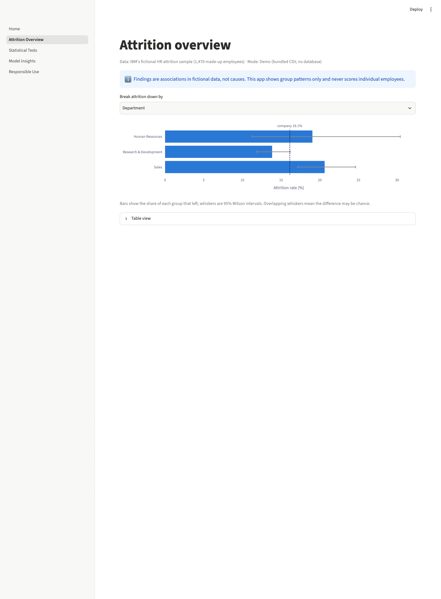
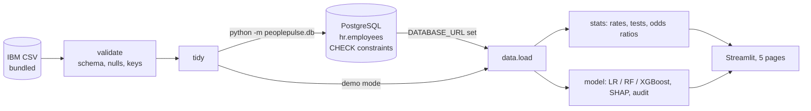
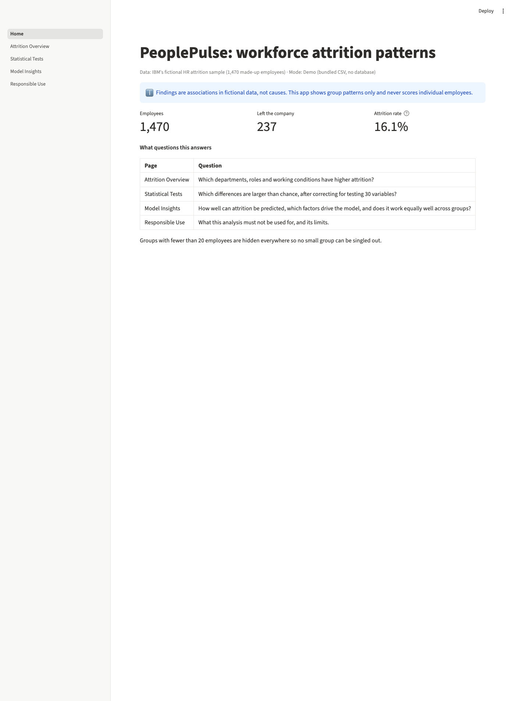
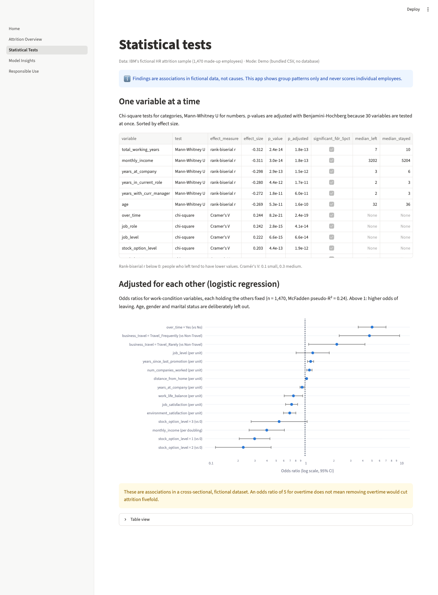

# PeoplePulse: workforce attrition patterns

A multi-page Streamlit app that finds **group-level** attrition patterns in HR data, with significance tests,
three predictive models explained with SHAP, and a fairness audit. It is built to show *where* to look, and by design
never scores an individual employee.

> **The data is fictional.** It is IBM's HR attrition sample: 1,470 employees that IBM data scientists invented
> for teaching. Nothing here describes a real company, and every finding is an association, not a cause.



## Questions it answers

| Question | Where | Answer (fictional data) |
|---|---|---|
| How many people leave? | Home | 237 of 1,470: **16.1%** (95% CI 14.3–18.1%) |
| Which groups leave most? | Attrition Overview | Sales Representatives 39.8% (CI 29.9–50.5%); overtime workers 30.5% vs 10.4% without |
| Which differences beat chance? | Statistical Tests | 20 of 30 variables after Benjamini-Hochberg correction; gender is not one of them (adjusted p = 0.35) |
| Which work conditions matter once the others are held fixed? | Statistical Tests | Overtime odds ratio **5.0** (CI 3.6–7.0); frequent travel 4.7 (CI 2.3–9.7) vs none; stock option level 1: 0.30 (CI 0.21–0.43); each doubling of income 0.40 (CI 0.26–0.61) |
| How well can attrition be predicted? | Model Insights | Holdout ROC-AUC **0.78** (CI 0.70–0.85) for logistic regression; PR-AUC 0.54 vs 0.16 by chance |
| Does the model work equally well across groups? | Model Insights | Holdout AUC 0.75 women / 0.80 men; 0.79 / 0.83 / 0.74 for ages 18–29 / 30–39 / 40+ (small groups, wide uncertainty) |

## Why this dataset

It is the standard public HR attrition dataset with a real target and the variables an HR analyst would actually
have (overtime, travel, satisfaction surveys, tenure, pay). It has no dates, no exit reasons and is fictional, so
the app treats it as a teaching set and says so on every page.

- Source: [IBM/employee-attrition-aif360](https://github.com/IBM/employee-attrition-aif360) (Apache-2.0), `data/emp_attrition.csv`
- SHA-256 of the bundled copy: `a5c31e38bd7fafc9bc333884eb181b06b41b8e5e488e8f7ccb27199fb3be7659`
- 1,470 rows, 35 columns, no missing values, no duplicate employee numbers. Three columns hold one value for
  everyone (`EmployeeCount`, `Over18`, `StandardHours`) and are dropped.

## How it works



- **Demo mode** (default): no `DATABASE_URL`, the app reads the bundled CSV. Nothing else to install.
- **Postgres mode**: `python -m peoplepulse.db` loads `hr.employees`, whose CHECK constraints reject impossible rows
  (for example more years at the company than years worked). The app then reads from Postgres. A test checks both
  modes return the same table.

## Methods

**Statistics** (`peoplepulse/stats.py`)
- Attrition rates with 95% Wilson intervals; groups under 20 employees are hidden.
- Chi-square with Cramér's V for categorical variables, Mann-Whitney U with rank-biserial r for numeric ones,
  Benjamini-Hochberg correction across all 30.
- Logistic regression on work-condition variables only (pseudo-R² 0.24), reported as odds ratios with CIs.

**Models** (`peoplepulse/model.py`)
- Logistic regression, random forest and XGBoost with fixed settings and class weighting. There was no tuning:
  with 237 leavers, tuning on the same data mostly fits noise.
- Stratified 80/20 split. The model is chosen by 5-fold cross-validation on the 80%; the 20% holdout
  (294 employees, 47 leavers) is used once, for the final numbers.
- Age, gender and marital status are **not inputs**; they are used only to audit the chosen model.

| Model | CV ROC-AUC | Holdout ROC-AUC (95% bootstrap CI) | Holdout PR-AUC | Brier |
|---|---|---|---|---|
| Logistic regression (chosen) | 0.827 ± 0.025 | 0.780 (0.703–0.855) | 0.543 | 0.162 |
| Random forest | 0.804 ± 0.029 | 0.780 (0.694–0.861) | 0.449 | 0.126 |
| XGBoost | 0.821 ± 0.030 | 0.768 (0.679–0.847) | 0.506 | 0.128 |

The simple model matched the complex ones; the holdout CIs overlap almost entirely. Brier scores are high because
class weighting makes probabilities uncalibrated, which is acceptable here since the app never shows a probability.

**SHAP** (XGBoost, holdout, mean |SHAP| with one-hot columns summed back to their variable): overtime, job role,
stock option level, business travel and number of previous employers rank highest. `daily_rate`, a column with no
documented meaning, still ranks 10th: SHAP shows what a model uses, not what is true.

## Responsible use

- **No individual risk scores.** `model.run` returns only aggregate tables, and a test fails if it ever returns
  per-employee output.
- Protected attributes are excluded from the model and used only for the per-group audit.
- Small groups are suppressed; multiple testing is corrected; the holdout is touched once.
- Every page states that the data is fictional and the findings are associations. Overtime going with attrition
  does not show that cutting overtime would reduce it.

## Screenshots

| Home | Statistical tests | Model insights |
|---|---|---|
|  |  |  |

## Run it

```bash
python -m venv .venv && source .venv/bin/activate
pip install -r requirements.txt
streamlit run Home.py                 # demo mode, no database needed

# optional: PostgreSQL mode
createdb peoplepulse
export DATABASE_URL=postgresql://localhost/peoplepulse
python -m peoplepulse.db              # loads 1,470 rows into hr.employees
streamlit run Home.py

python -m peoplepulse                 # rewrites results/*.csv and summary.json (the numbers above)
```

Docker: `docker build -t peoplepulse . && docker run -p 8501:8501 peoplepulse`

## Tests

`python -m pytest -q` runs 18 tests: data contract, Wilson intervals, small-group suppression, multiple-testing
correction, protected attributes excluded, aggregate-only model output, metric sanity, SHAP aggregation, the
Postgres round trip and CHECK constraints, and every app page running headless in demo mode. CI runs them against
a Postgres 17 service container and builds the Docker image.

## Deployment

Live on Streamlit Community Cloud: <https://peoplepulse-qqqhgssuz7vqxbze3wxvji.streamlit.app/> (main file `Home.py`,
demo mode, no secrets). The app shows the model results that `python -m peoplepulse` writes to `results/`, rather than
training on the free host, so pages open at once; rerun that command after changing the model.

## Limitations

- Fictional data, one snapshot, no dates: no trends, survival analysis or exit reasons.
- 237 leavers: role-level rates and per-group audit AUCs have wide intervals.
- Cross-sectional associations only; nothing here is causal.
- `DailyRate`, `HourlyRate` and `MonthlyRate` have no documented meaning and behave like noise.

## Future work

- Survival analysis (time to exit) on a dataset with hire and exit dates.
- Probability calibration if a use case ever needs group-level expected counts.
